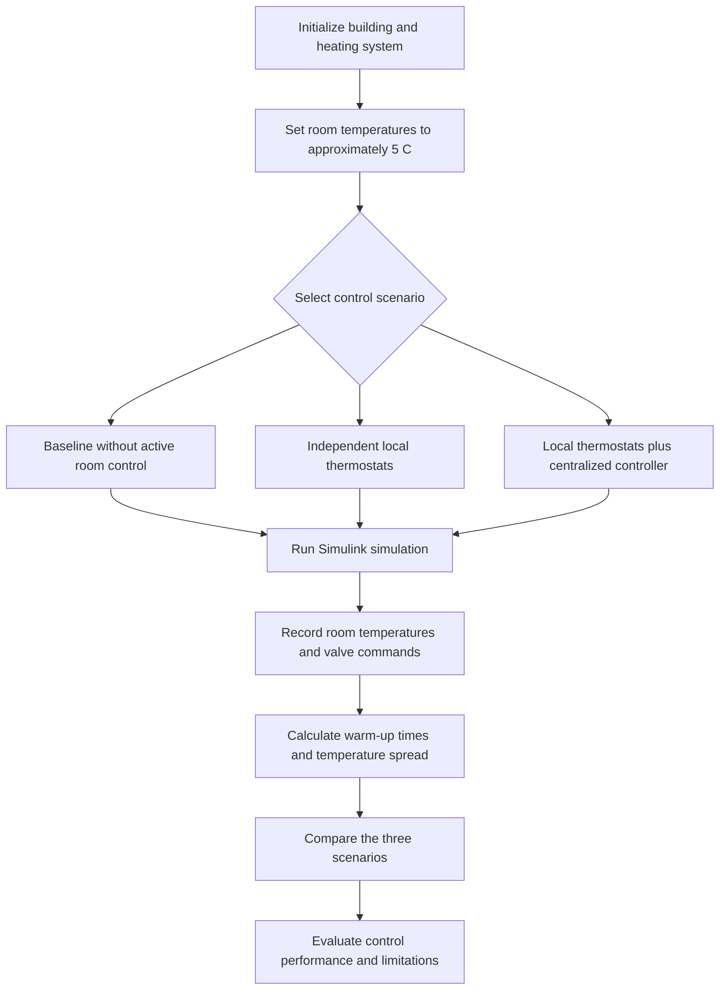

# Centralized Temperature Control of a Hydronic Heating System in MATLAB/Simulink

**Dynamic Simulation and Coordinated Room-Temperature Control in a Multifamily Building**

Bachelor Thesis · [Mechanical Engineering] · [Technische Hochschule Ingolstadt] · 2025  
[Ferdinand Yurichson]

[Thesis PDF](01_Thesis/thesis.pdf) · [Simulink Model](02_Model/main_model.slx) · [Control Logic](03_Control/central_control_logic.m) · [Simulation Results](05_Results/README.md)

---

## The Problem

In a multi-room hydronic heating system, rooms do not necessarily warm up at the same rate. Differences in room heat losses, thermal properties, radiator behaviour, and heating-system operation can result in some rooms reaching their target temperature considerably earlier than others.

Independent room thermostats regulate individual rooms according to their own temperature setpoints, but they do not necessarily coordinate the warm-up process across the building.

This project investigates whether a centralized supervisory controller can improve the uniformity of room warm-up by coordinating radiator-valve operation according to the temperatures of the rooms.

The study uses a MATLAB/Simulink model of a real three-storey multifamily building with six residential units and 36 rooms. The initial room temperature is approximately 5 degrees Celsius, and the main warm-up target is 20 degrees Celsius.

**Research question:** Can centralized coordination of radiator valves reduce the difference between the earliest and latest rooms reaching 20 degrees Celsius compared with independent local thermostats?

## The Approach

The heating system is modelled in MATLAB/Simulink using Simscape components. The building model represents room thermal behaviour, heat exchange with the outdoor environment and neighbouring rooms, and heat supplied by radiators.

The hydronic system includes a basement heat source, hot-water storage, a circulation pump, distribution pipes, radiator valves, and room-level temperature control.

The controller is evaluated in three scenarios:

1. **Baseline:** Heating-system response without active room-temperature control.
2. **Local control:** Each room independently regulates its radiator valve using a thermostat with hysteresis.
3. **Centralized control:** Local thermostats operate alongside a supervisory controller that coordinates valve operation using room-temperature information.

The centralized controller restricts heating in rooms that warm up faster or are relatively warm, according to the implemented control logic, to help colder rooms catch up. Local thermostats continue to regulate the individual room temperatures.

The three scenarios are compared using the same building model and initial conditions.

## Model Overview

| Component | Description |
|---|---|
| Building | Three storeys, six residential units, 36 rooms |
| Initial room temperature | Approximately 5 degrees Celsius |
| Warm-up target | 20 degrees Celsius |
| Heat source | Basement heating system with hot-water storage |
| Circulation | Pump-driven hydronic heating network |
| Radiators | Simplified pipe-based thermal models |
| Distribution pipes | Simscape Thermal Liquid Pipe components with different pipe lengths |
| Distribution-pipe insulation | Ideal insulation; heat exchange with surroundings is neglected |
| Local control | Room thermostats with hysteresis |
| Supervisory control | Centralized temperature-based coordination of radiator valves |
| Simulation platform | MATLAB/Simulink and Simscape |

### Pipe and Radiator Modelling

Radiators and distribution pipes are represented using Simscape Thermal Liquid Pipe components.

Radiator components transfer heat from the circulating water to their associated rooms. This is a simplified representation of conventional radiator behaviour.

Distribution-pipe lengths represent the different pipe routes between the basement heat source and the radiators. The distribution pipes are assumed to be ideally insulated, so external heat loss from these pipes is neglected.

The model does not explicitly evaluate hydraulic balancing through a design calculation of required radiator flow rates and pressure losses. Although the Simscape pipe components can represent hydraulic resistance, the resulting flow distribution depends on the complete hydraulic network, pump characteristics, valve behaviour, and component configuration.

## Results

The principal result is the reduction in the difference between the earliest and latest rooms reaching the target temperature when centralized supervisory control is introduced.

The following table should be populated with the actual measurements from your simulation.

| Performance metric | Baseline | Local thermostats | Centralized control |
|---|---:|---:|---:|
| Earliest room to reach 20 degrees Celsius | [Value] | [Value] | [Value] |
| Latest room to reach 20 degrees Celsius | [Value] | [Value] | [Value] |
| Warm-up-time spread | [Value] | [Value] | [Value] |
| Maximum room-temperature spread | [Value] | [Value] | [Value] |

### Key Performance Metric

The warm-up-time spread is calculated as:

Warm-up-time spread = Latest room warm-up time - Earliest room warm-up time

A smaller spread indicates that the rooms reach the target temperature more synchronously.

The centralized controller's improvement relative to the local-thermostat scenario can be calculated as:

Improvement (%) = (Local-control spread - Centralized-control spread) / Local-control spread x 100

This percentage should be reported only when the local-control spread is greater than zero and both scenarios use comparable simulation conditions.

### Observed Valve and Flow Behaviour

In a preliminary two-room test, the branch flow measurements changed when the nearer room reached its target temperature and its valve closed. The reported flow in that branch fell to zero, while the reported flow in the other branch increased.

This observation is consistent with a change in network flow distribution following valve closure. It should be interpreted in conjunction with the pump characteristics, pipe configuration, valve behaviour, measurement locations, and verified signal units.

The flow measurements alone do not establish that the complete system is hydraulically balanced.

## How It Works

## Repository Workflow

| Stage | Activity | Main files |
|---|---|---|
| 1. Model development | Build the building thermal model and hydronic heating network | `02_Model/main_model.slx` |
| 2. Initialization | Set initial temperatures and simulation parameters | `04_Simulations/initialize_model.m` |
| 3. Baseline simulation | Establish the reference heating response | `04_Simulations/run_case_1_baseline.m` |
| 4. Local control | Evaluate independent thermostat operation | `04_Simulations/run_case_2_local_thermostats.m` |
| 5. Centralized control | Evaluate coordinated valve operation | `04_Simulations/run_case_3_centralized_control.m` |
| 6. Comparison | Calculate warm-up-time differences and temperature spread | `05_Results/` |
| 7. Documentation | Record modelling assumptions, control logic, and findings | `06_Documentation/` |

## Model Assumptions and Limitations

The simulation is intended primarily for comparing heating-control strategies under consistent modelling conditions.

The main assumptions and limitations are:

- Radiators are represented using simplified pipe-based thermal models.
- Distribution pipes have different lengths but are treated as ideally insulated.
- Hydraulic pressure losses and branch-flow behaviour must be interpreted according to the configured Simscape network and pump model.
- The controller is evaluated using the room-temperature information and control logic implemented in the model.
- Performance in alternative building layouts has not been established unless those layouts are separately simulated.
- Simulation results demonstrate behaviour under the model assumptions and do not, by themselves, constitute experimental validation against measurements from the physical building.

The project focuses on coordinated room-temperature control and warm-up uniformity. Formal hydraulic balancing would require additional analysis of design flow rates, pressure losses, and hydraulic operating conditions.

## Repository Structure

- `01_Thesis/` - Thesis document and thesis figures.
- `02_Model/` - Main MATLAB/Simulink model.
- `03_Control/` - Centralized supervisory control logic.
- `04_Simulations/` - Initialization and scenario execution scripts.
- `05_Results/` - Simulation outputs, plots, and quantitative comparisons.
- `06_Documentation/` - Model architecture, parameters, control strategy, assumptions, and validation.
- `07_References/` - Bibliographic references used in the thesis.

## Requirements

The project requires MATLAB and Simulink, together with the Simscape products needed by the model.

Exact software versions should be documented after checking the MATLAB release and installed toolboxes used to create and run the simulations.

## Reproducing the Simulations

1. Clone or download this repository.
2. Open MATLAB and navigate to the project directory.
3. Open `02_Model/main_model.slx`.
4. Check the required Simulink and Simscape products and model parameters.
5. Run the initialization script, if required.
6. Run the three scenario scripts using the same initial conditions and simulation settings.
7. Compare the resulting room-temperature trajectories, warm-up times, and valve behaviour.

The repository should include the scripts and configuration required to reproduce the reported results. Any model dependencies, external files, or manual configuration steps should be documented before publication.

## Future Work

Potential extensions include:

- Testing the centralized controller with alternative room arrangements and building configurations.
- Investigating the effect of different pipe lengths, diameters, and insulation assumptions.
- Evaluating the hydraulic network using explicit flow-rate and pressure-drop analysis.
- Improving radiator modelling and validating heat output against reference data.
- Evaluating valve switching, control stability, and room-temperature regulation over longer simulation periods.

